<p align="center">
  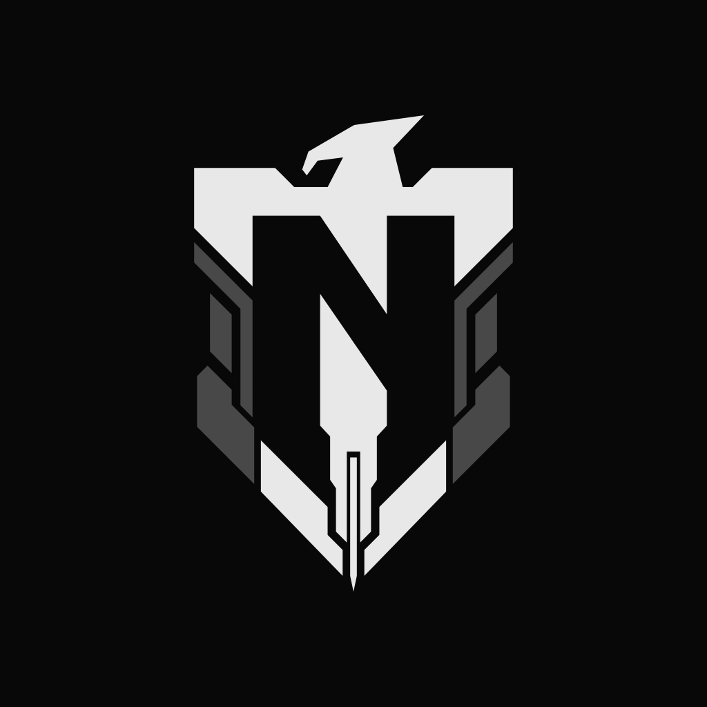
</p>

# NOTORYX Core Ham

**Off-grid LoRa mesh messaging for licensed US amateur radio operators.** Part of the **NOTORYX** family. **No Towers. No Limits.**

> [!WARNING]
> **Use only after a great deal of coordination.** NOTORYX Core Ham and its firmware transmit automatically on shared amateur bands, and every repeater relays under its operator's licence. Before any radio goes on the air, coordinate with your frequency coordinator, the local band plan and every operator in your area. Read **[the coordination guide](docs/licensed-operator/COORDINATION.md)** first.

NOTORYX Core Ham is the amateur radio (FCC Part 97) edition of NOTORYX Core. Paired with radios running the **[NOTORYX Ham firmware](https://github.com/TheLogsAreScreaming/NOTORYX-Core-Ham-Firmware)**, it gives you MeshCore-style mesh messaging on 33 cm and 70 cm, with your call sign on every transmission and nothing encrypted. It installs as its own app (`com.bastionmesh.ham`), next to NOTORYX Core.

<p align="center">
  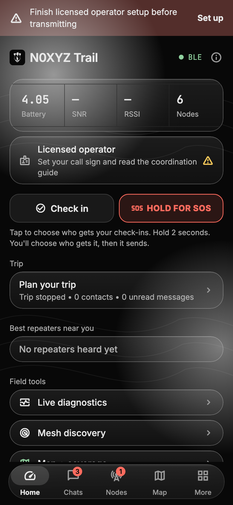
  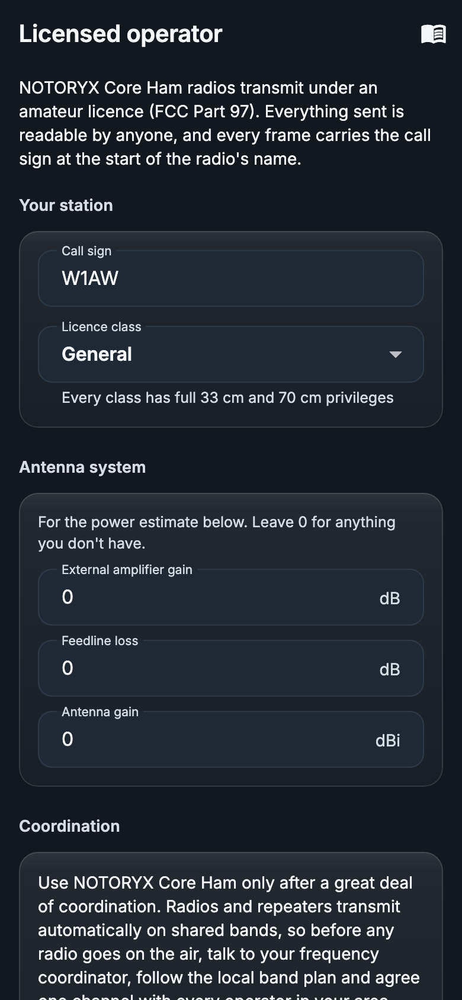
  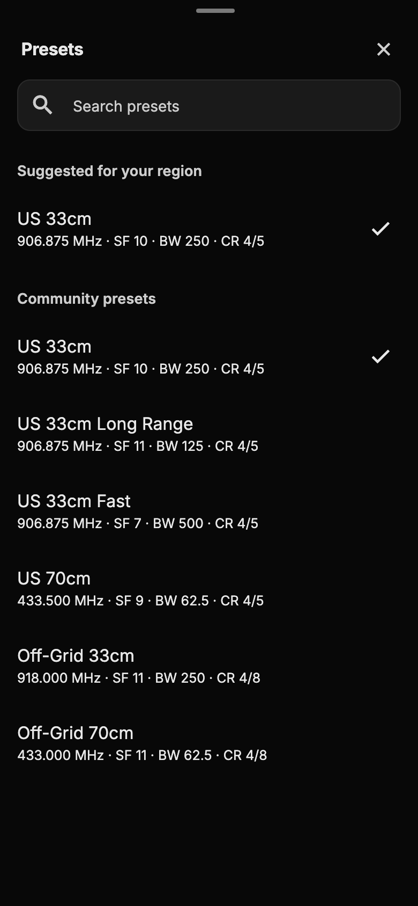
</p>

> **Status: test builds.** The latest is **[test 17](https://github.com/TheLogsAreScreaming/NOTORYX-Core-Ham-Releases/releases/tag/v0.1.0-test.17)** (`0.1.0-test.17`, 19 November 2026). The app and firmware pass automated tests and a mesh simulator, but have **not been tested on the air yet**. Use them only on a bench with dummy loads or minimum power until they have been. Everything you send is readable by anyone: that's the law on amateur bands, not a bug.

## What makes it a ham app

| | NOTORYX Core (Part 15) | NOTORYX Core Ham (Part 97) |
|---|---|---|
| Station ID | none | Your call sign ends every frame, including frames a repeater relays (§97.119) |
| No call sign, no transmission | — | The radio stays silent until its name starts with a valid call sign |
| Content | AES encrypted | Plain text; authentication kept (§97.113(a)(4)) |
| Bands | regional presets | 33 cm (902–928 MHz) and 70 cm (420–450 MHz) only |
| Repeater login | password sent encrypted | One-time proof; the password never goes on air |
| Other traffic | — | Ordinary (Part 15) MeshCore traffic on the same channel is ignored |
| Operator | — | **Licensed operator** setup: call sign, licence class and a coordination acknowledgment |
| Power | — | Estimated output and ERP from the board's amplifier and your antenna system, flagged above 10 W (§97.311) |
| Location | — | Cautions for the §97.303 limits: the 33 cm exclusion areas and 420–430 MHz north of Line A |

The NOTORYX Ham firmware isn't compatible with ordinary MeshCore on the air. Every radio in your mesh, repeaters included, needs it.

## Supported radios

| Radio | Companion (connect the app) | Repeater |
|---|---|---|
| Heltec V4 | Bluetooth or USB | ✓ |
| Heltec T114 | Bluetooth or USB | ✓ |
| RAK WisBlock / WisMesh (RAK4631) | Bluetooth or USB | ✓ |
| RAK WisMesh 1W Booster (RAK3401 + 13302) | Bluetooth or USB | ✓ |
| Seeed Studio SenseCAP T1000-E | Bluetooth or USB | — |
| UnitEng Station G2 | Bluetooth or USB | ✓ |
| UnitEng Station G3 | Bluetooth or USB | ✓ |

The Station G2 and G3 Bluetooth companion is in [firmware test 3](https://github.com/TheLogsAreScreaming/NOTORYX-Core-Ham-Releases/releases/tag/v1.18.0-ham-test.3).

**Compiled but never flashed:** [firmware test 4](https://github.com/TheLogsAreScreaming/NOTORYX-Core-Ham-Releases/releases/tag/v1.18.0-ham-test.4) adds companion and repeater builds for 14 more boards: Heltec V3, Heltec Wireless Stick Lite V3, Seeed SenseCAP Solar Node, Seeed Wio Tracker L1, Seeed Xiao nRF52 kit, Seeed Xiao S3, LilyGO T-Beam (SX1262 or SX1276), LilyGO T-Beam S3, nRF52 Pro Micro DIY, LilyGO T-Echo, LilyGO T-LoRa V2.1-1.6, LilyGO T3-S3 (SX1262 or SX1276), LilyGO T-Deck and RAK WisMesh Tag. None has been run on its board yet, so they may not boot.

Companion builds can be flashed from the browser with the **[web flasher](https://www.meshmayhem.org/hamwebflasher/)**. The firmware's transmit power is the radio chip's setting; boards with an amplifier put out more, so use the least power that works.

## Getting started

1. **Coordinate first.** Read the [coordination guide](docs/licensed-operator/COORDINATION.md) and agree a channel with your frequency coordinator and local operators.
2. **Flash the NOTORYX Ham firmware** on every radio. See the [firmware repository](https://github.com/TheLogsAreScreaming/NOTORYX-Core-Ham-Firmware) for builds and flashing.
3. **Set up your operator.** Open **Settings → Licensed operator**, enter your call sign and licence class, read the guide and tick the acknowledgment. Until you do, a banner reminds you on every screen while a radio is connected.
4. **Name your radio with your call sign.** The Licensed operator page offers **Set to W1AW** (with your call); you can add a suffix like `W1AW-2` or `W1AW Base`.
5. **Pick the agreed channel.** **Settings → Radio settings → Presets** starts with **US 33cm**, the firmware default.
6. **Check power and location.** On the Licensed operator page, enter any external amplifier, feedline loss and antenna gain. It estimates your output and ERP and warns about §97.303 location limits. Use the least power that works, and do an RF exposure evaluation before running higher power.

The tabs at the bottom are **Home**, **Chats**, **Nodes**, **Map** and **More**. Home is where check-in, SOS and your radio's readings live; **More** holds every tool and setting, with a search box.

## Downloads

Test builds are in **[NOTORYX-Core-Ham-Releases](https://github.com/TheLogsAreScreaming/NOTORYX-Core-Ham-Releases/releases)**:

- **Android** (arm64 APK, signed). Each test build installs over the last one. Back up first.
- **macOS** (Intel and Apple Silicon, macOS 14 or later). It isn't notarized, so Control-click the app and choose **Open** the first time.
- **Firmware** for the boards above, and the [web flasher](https://www.meshmayhem.org/hamwebflasher/).

There's also a [download page](https://www.meshmayhem.org/ham/). They're all test builds and haven't been tried on the air.

## Features

Everything from NOTORYX Core, working over plain-text ham frames:

### Safety and trips
- **SOS:** hold for 2 seconds to send your radio's position to your trip contacts (and an optional channel). It repeats every 5 minutes until someone replies or you stop it, and **I'm safe** sends an all-clear.
- **Signed SOS:** an SOS on a channel carries a signature from your radio's own key, so other NOTORYX users can see it really came from you. You can sign every channel post too. A post whose signature doesn't check out is shown as unverified, and other apps just see the normal message.
- **Check-ins:** I'm OK, At camp, Delayed and Heading back. You see who each one reached, and can resend to anyone it missed.
- **Check-in reminders and overdue alerts:** a notification when you're due to check in, and a warning when a trip contact goes quiet for longer than you set.
- **Trip planning:** pick up to six contacts. Trip briefs, a Field Log of everything sent and received, and optional automations.
- **Trip readiness check** before you head out, and **offline checklists** (such as "Before a trip" and "Putting up a node") with shareable run records.
- **SALUTE and 9-Line reports** from the SOS panel and the check-in card. They go as plain text with your call sign, only when you press Send.
- The SOS panel says plainly that it only reaches your chosen contacts and radios in range, and doesn't contact 911 or emergency services.
- **Android home-screen widget:** radio status, battery and unread count, with one-tap Check in and SOS.

### Messaging
- Direct and channel messages with delivery status, reactions, GIFs and picture messages, up to 152 characters. Pictures are sent in 157-byte chunks to fit ham frames. Tapping a notification opens that chat.
- **Replies** to a specific message, including from a notification, and **forwarding**: long-press, pick a destination and press Send. It goes out as `FWD de <your call> from <writer>: <text>`.
- **Find channels:** a directory of public hashtag channels (local ones first), channels heard on air that you haven't joined, and **Active online**: the #channels an online analyzer has seen in use, with one-tap Join.
- **Message search**, per-chat **drafts**, **read aloud** and on-device translation.
- **Share your position or a contact** from the message box. Received contacts can be added in one tap.
- **Link previews** (off by default, since fetching one tells the site your IP address).
- **Area-limited channel messages** that stay within a radius of you. These need radios running flood-corridor firmware.
- Optional auto-delete of old channel messages.

### Maps, paths and coverage
- Live mesh map with offline map packs, and a **track log** that records your trail and exports GPX.
- **Live Traffic map:** turn on **Traffic** in the map toolbar to see every packet the radio hears drawn from where it started, through each repeater, to you, coloured by packet type. It only listens; nothing is stored or sent.
- **Stale nodes and range rings:** nodes not heard for a time you choose are marked stale and faded on the map, and the map can draw distance rings around your position.
- **Path graph:** every path you've heard, drawn as flows from far repeaters to you. Short (1-byte) hops are matched to a specific repeater using longer paths.
- **Route Intelligence:** learned routes and the best repeaters your radio hears directly.
- **Observer reach:** check which online observers heard a message you sent, how many hops it took and the best signal. Repeaters you don't have as contacts can be named online. Both use a CoreScope analyzer you choose in Settings.
- **Coverage hexagons:** record where your radio got through and upload to your own HTTPS endpoints, with a privacy delay.
- **Antenna coverage** over the terrain and coverage capture sessions, plus an **antenna coverage estimate**.
- **Line of sight** with the **Fresnel zone**: the profile shades the first Fresnel zone with a dashed 60% line and says whether it's clear, partly clear or blocked. It uses your radio's frequency, or 906.875 MHz if the radio hasn't reported one.
- **Compass to a node:** an arrow that points at any node with a position, corrected to true north, with distance and bearing. Open it with **Point me to it** from a node's long-press menu, its map card or its Details sheet. It needs a phone with a compass sensor.
- **Maidenhead grid locators**, **waypoints** with GPX import and export, **offline trail routing** and **place search**.
- **Route view and route picker:** chart each hop of the route to a contact, score the routes heard, and pick or build one.
- **Day replay:** play back where nodes were on a chosen day, from adverts your radio already heard.
- **Trace card:** share a path trace as an image or text, with an offline sketch of the route.
- **Signed coverage reports:** share coverage as a signed report that others can check. The signature is only on the shared file or upload; nothing about it goes on air.

### Your radio
- **Sensors on Home:** your radio's own readings (battery voltage, temperatures, GPS, light and whatever else it reports).
- **Radio presets:** US 33 cm (906.875 MHz, the firmware default), 33 cm Long Range, 33 cm Fast, US 70 cm and off-grid 33/70 cm. Frequency fields only accept 420–450 and 902–928 MHz. Choosing a preset keeps your transmit power. Coordinated local settings can be offered by area; see [adding your area](#add-your-areas-mesh-settings).
- **Send your advert** zero-hop (only radios that hear you directly) or flooded across the mesh.
- **Nearby repeater test:** one tap sends a single zero-hop discover request and lists the repeaters that answer, strongest first.
- **Mesh health** card, route health warnings and **network change alerts** with a troubleshooting guide.
- **Node journal:** every node heard, with behaviour labels, a generated mark to tell nodes apart, and your own tags and notes. A **Timeline** puts messages, newly heard nodes, big signal swings and places in one feed.
- Connections dashboard, live radio stats and a noise-floor chart, adjustable refresh rate and battery saver.
- Command line and Wi-Fi setup for your own radio. With permission, you can also use a trusted contact's command line.

### Field tools
- **Repeater ping:** a one-hop trace showing the signal both ways. **Antenna hunt:** clicks faster as a chosen repeater gets louder.
- Repeater and room-server tools: login, status, neighbors, telemetry, command line and **access control**.
- **Repeater IDs** (who uses an ID, which are free) and **Region setup** (US and Canada region trees, or your own) for repeater owners.
- **Bot Mode:** local auto-replies, keyword rules and commands like `!ping`, `!sun`, `!moon`, `!dice` and `!trace`, in direct messages and in the channels you choose.
- **Automation rules** (Tools → Automation): triggers such as battery, time, area or a node going offline that raise an alert, play a sound, change the working channel, call a webhook or send a message. Automatic sends are held until the station is set up with your call sign, prefixed `[auto]`, limited to 3 every 10 minutes and logged. Read [AUTOMATION.md](docs/licensed-operator/AUTOMATION.md) and agree any rule with your coordinator before using it on the air.
- **Team config:** share radio settings and hashtag channels by QR code or file. No keys or power settings are included, and frequencies outside 70 cm and 33 cm are refused.
- **Field guide**, app-icon shortcuts, and **backup and restore**, including message history.
- **App lock** with fingerprint, face or screen lock (SOS stays on the lock screen). Contacts, channel keys, waypoints and drafts are stored encrypted on the phone, and message history can be too (off by default). That's storage only; nothing on the air is encrypted.

### MQTT bridge (optional)
- **Think before bridging.** Linking a ham mesh to the internet raises third-party traffic questions (§97.115); the [coordination guide](docs/licensed-operator/COORDINATION.md) covers it. Only frames with a station ID are used, so encrypted Part 15 traffic from other observers is ignored.
- **Several brokers at once** over TLS or secure WebSocket, with a Wi-Fi-only option and an offline queue that sends when you're back online. Broker passwords are kept in the system keychain.
- **Live packet feed.** Channel messages that reached you only over the internet are marked **via MQTT**, and never count as radio repeats.
- **Observer sharing** in the community `meshcoretomqtt` format. It's off until you turn it on, and direct messages and your own traffic each need a separate opt-in.
- **LetsMesh-style sign-in** with a token signed by your radio, so its private key never leaves it. LetsMesh (US and EU) and MeshRank presets are included; they're community services, not part of NOTORYX.

### Look and feel
- **Frosted ember:** the main screens sit on a glow in your theme's colours, with see-through glass panels and a floating tab bar. With reduce motion turned on, the blur is off.
- Eight themes: **Blaze** (the default), **Neon Anarchy**, **Tactical**, **Pink Overload**, **Bare Beauty**, **Okabe-Ito** (colour-vision friendly), **Night Ops** and **Seasonal**.
- **Your own background:** **Settings → Background** puts a colour, gradient, mesh blend or your own photo behind the glass cards.
- **A photo or colour per node:** from a node's sheet, give it a colour or photo. It shows in Nodes, the map and chats, stays on this phone and is never sent over the radio.
- Available in 18 languages.

<p align="center">
  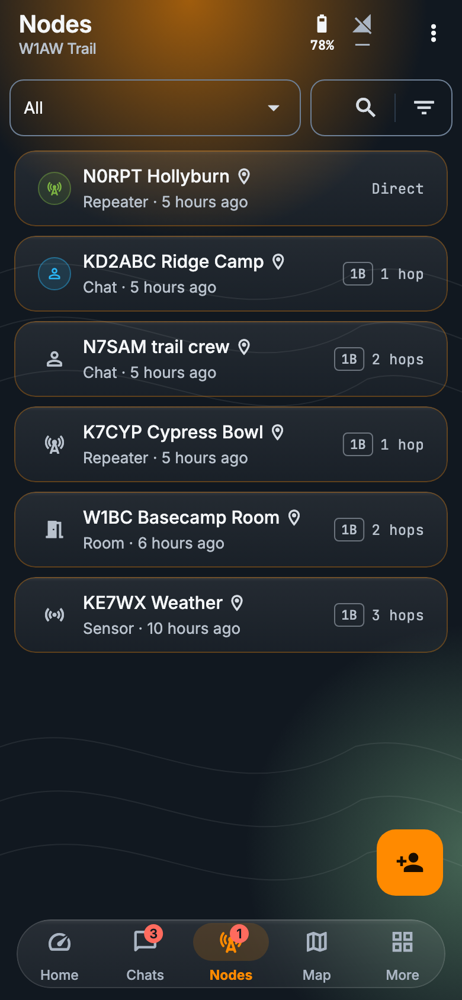
  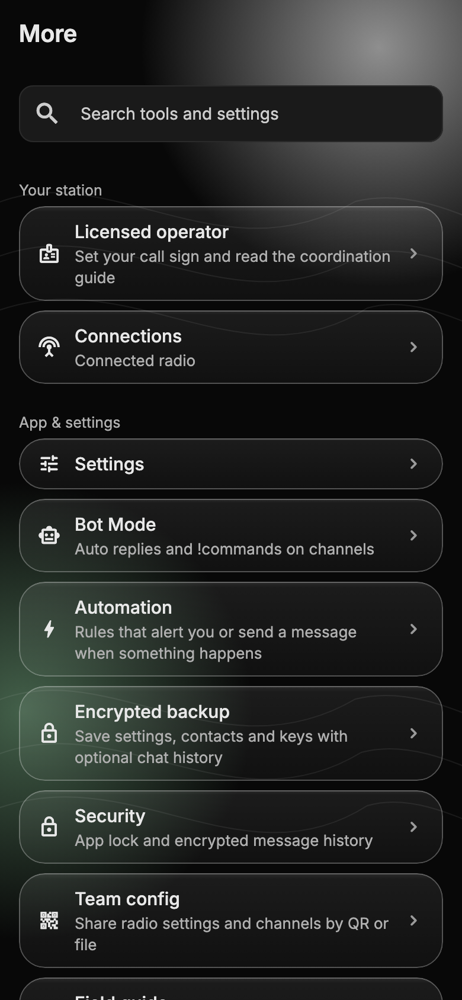
  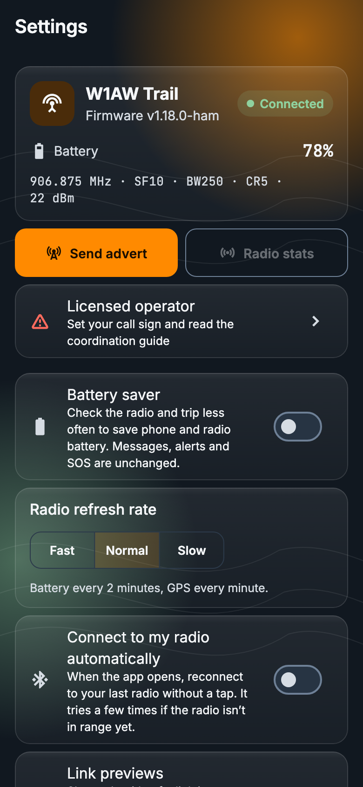
</p>

<p align="center">
  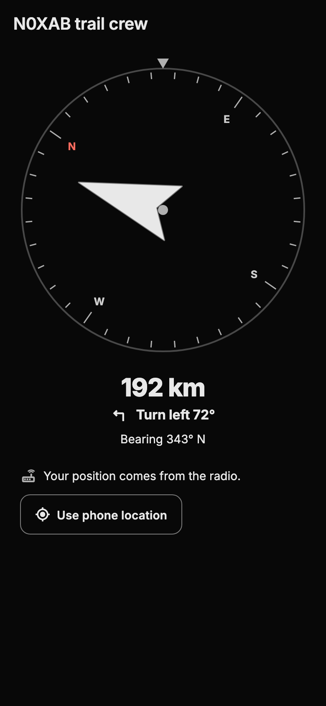
  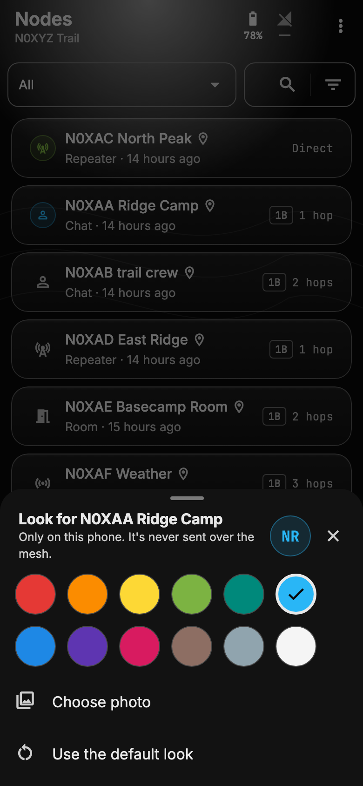
  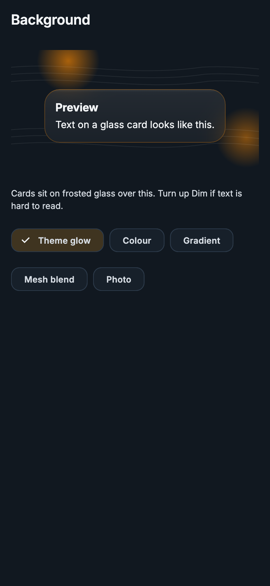
</p>

<p align="center">
  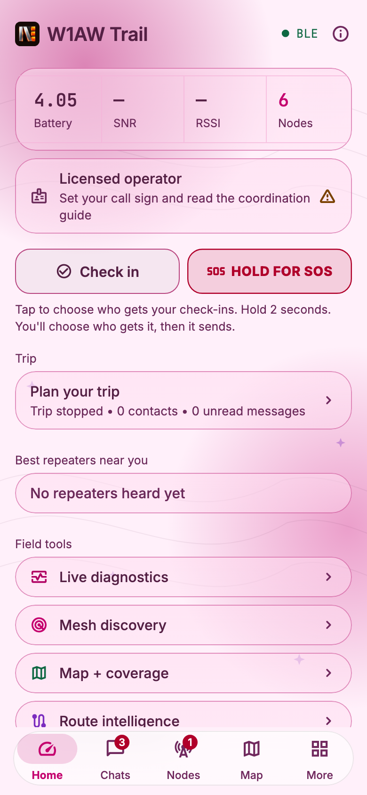
  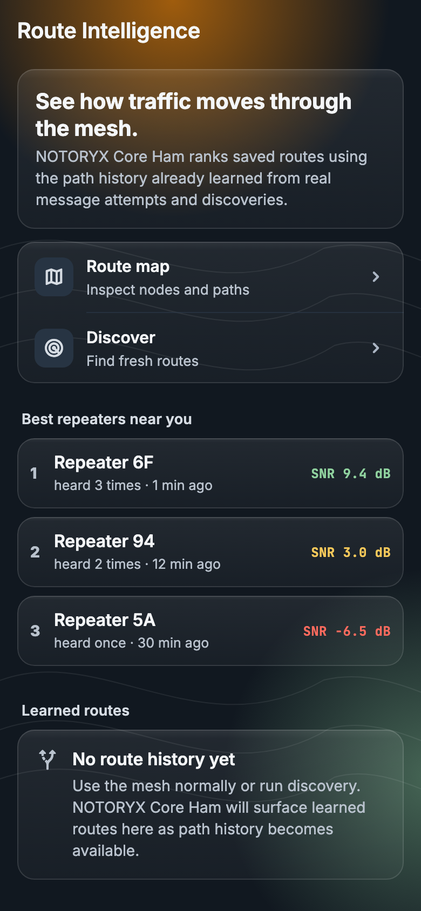
  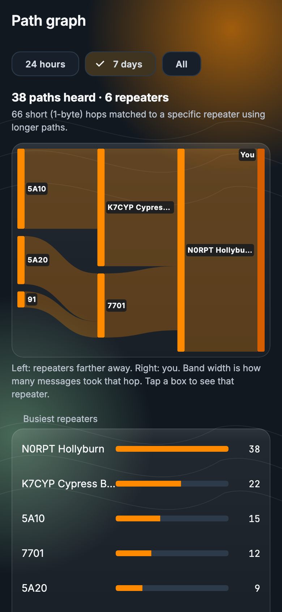
</p>

## Add your area's mesh settings

NOTORYX Core Ham can offer a coordinated channel to everyone in an area. The live list is [`regional_presets.json` in NOTORYX-Core-Ham-Releases](https://github.com/TheLogsAreScreaming/NOTORYX-Core-Ham-Releases/blob/main/regional_presets.json), checked every 12 hours; the app bundles a copy, [`assets/regional_presets.json`](assets/regional_presets.json), for offline use. It's empty for now. Only ham-band entries are accepted, and Part 15 MeshCore meshes don't belong here.

To add an area your frequency coordinator has agreed, [open an issue in NOTORYX-Core-Ham-Releases](https://github.com/TheLogsAreScreaming/NOTORYX-Core-Ham-Releases/issues/new). Each entry looks like this:

```json
{
  "id": "us-example",
  "name": "Example County",
  "center": [39.9526, -75.1652],
  "radiusKm": 60,
  "frequencyMHz": 906.875,
  "bandwidthKHz": 250,
  "spreadingFactor": 10,
  "codingRate": 5,
  "pathHashBytes": 1,
  "updated": "2026-11-05",
  "notes": "Who coordinated this channel, and anything operators should know."
}
```

Say in `notes` who agreed the channel. Change `updated` whenever the settings change: that's what triggers the "settings changed" notification.

## Building from source

You'll need [Flutter](https://flutter.dev) 3.47 (stable).

```bash
flutter pub get
flutter run
```

Release builds:

```bash
flutter build apk --release --target-platform android-arm64
flutter build appbundle --release   # Google Play
flutter build macos --release
```

The Android application ID is `com.bastionmesh.ham`, so it installs next to NOTORYX Core (`com.bastionmesh.bastion`).

Before opening a pull request, run:

```bash
dart format lib test
flutter analyze --fatal-infos
flutter test
```

### Project layout

- `lib/connector/`: MeshCore protocol and the Bluetooth, USB and TCP transports
- `lib/screens/`: app screens
- `lib/services/`: field ops, coverage, routing, MQTT, notifications and other services
- `lib/models/`, `lib/storage/`: data and persistence
- `lib/theme/`: themes and colors
- `lib/utils/amateur_radio.dart`: ham frame handling, call-sign and band checks shared with the firmware
- `docs/licensed-operator/`: the coordination guide and the Part 97 feasibility notes
- `test/`: unit and widget tests; `test/preview/` renders screenshots with demo data (`PREVIEW_OUT=dir flutter test test/preview`; `PREVIEW_THEME=okabe_ito,night_ops` picks themes and `PREVIEW_ONLY=home,node_compass` picks screens)

## Contributing

Bug reports, feature requests and pull requests are welcome. Use the **[Issues](../../issues)** tab, and see [`CONTRIBUTING.md`](CONTRIBUTING.md) before opening a pull request.

## Independence and attribution

NOTORYX Core Ham is an independent community app. It is not an official MeshCore app and doesn't imply endorsement by MeshCore. For MeshCore itself, see [meshcore.io](https://meshcore.io/).

NOTORYX Core Ham is the amateur edition of NOTORYX Core and builds on the open-source [MeshCore Open](https://github.com/zjs81/meshcore-open) project. License text and third-party notices are in [`LICENSE`](LICENSE), [`THIRD_PARTY_NOTICES.md`](THIRD_PARTY_NOTICES.md) and the app's Open source licenses screen.

## License

[MIT](LICENSE).
