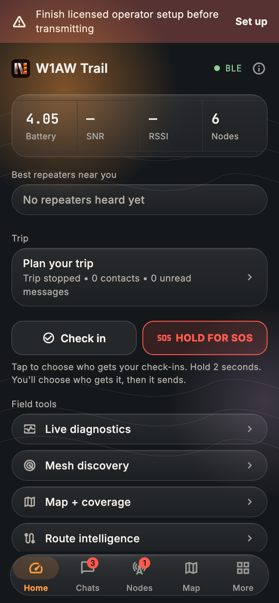

<p align="center">
  
</p>

# NOTORYX Core Ham

**Off-grid LoRa mesh messaging for licensed US amateur radio operators.** Part of the **NOTORYX** family. **No Towers. No Limits.**

> [!WARNING]
> **Use only after a great deal of coordination.** NOTORYX Core Ham and its firmware transmit automatically on shared amateur bands, and every repeater relays under its operator's licence. Before any radio goes on the air, coordinate with your frequency coordinator, the local band plan and every operator in your area. Read **[the coordination guide](docs/licensed-operator/COORDINATION.md)** first.

NOTORYX Core Ham is the amateur radio (FCC Part 97) edition of NOTORYX Core. Paired with radios running the **[NOTORYX Ham firmware](https://github.com/TheLogsAreScreaming/NOTORYX-Core-Ham-Firmware)**, it gives you MeshCore-style mesh messaging on 33 cm and 70 cm, with your call sign on every transmission and nothing encrypted. It installs as its own app (`com.bastionmesh.ham`), next to NOTORYX Core.

<p align="center">
  
  
  
</p>

> **Status: in development.** The app and firmware pass automated tests and a mesh simulator, but have **not been tested on the air yet**. There are no public builds. Everything you send is readable by anyone: that's the law on amateur bands, not a bug.

## What makes it a ham app

| | NOTORYX Core (Part 15) | NOTORYX Core Ham (Part 97) |
|---|---|---|
| Station ID | none | Your call sign ends every frame, including frames a repeater relays (§97.119) |
| No call sign, no transmission | — | The radio stays silent until its name starts with a valid call sign |
| Content | AES encrypted | Plain text; authentication kept (§97.113(a)(4)) |
| Bands | regional presets | 33 cm (902–928 MHz) and 70 cm (420–450 MHz) only |
| Repeater login | password sent encrypted | One-time proof; the password never goes on air |
| Other traffic | — | Ordinary (Part 15) MeshCore traffic on the same channel is ignored |
| Operator | — | **Licensed operator** setup: call sign, licence class and a coordination acknowledgment |

The NOTORYX Ham firmware isn't compatible with ordinary MeshCore on the air. Every radio in your mesh, repeaters included, needs it.

## Supported radios

| Radio | Companion (connect the app) | Repeater |
|---|---|---|
| Heltec V4 | Bluetooth or USB | ✓ |
| Heltec T114 | Bluetooth or USB | ✓ |
| RAK WisBlock / WisMesh (RAK4631) | Bluetooth or USB | ✓ |
| RAK WisMesh 1W Booster (RAK3401 + 13302) | Bluetooth or USB | ✓ |
| Seeed Studio SenseCAP T1000-E | Bluetooth or USB | — |
| UnitEng Station G2 | USB | ✓ |
| UnitEng Station G3 | USB | ✓ |

Station G2 and G3 companions are USB only: the Bluetooth build doesn't fit on those boards (the same as stock MeshCore v1.18.0). The firmware's transmit power is the radio chip's setting; boards with an amplifier put out more, so use the least power that works.

## Getting started

1. **Coordinate first.** Read the [coordination guide](docs/licensed-operator/COORDINATION.md) and agree a channel with your frequency coordinator and local operators.
2. **Flash the NOTORYX Ham firmware** on every radio. See the [firmware repository](https://github.com/TheLogsAreScreaming/NOTORYX-Core-Ham-Firmware) for builds and flashing.
3. **Set up your operator.** Open **Settings → Licensed operator**, enter your call sign and licence class, read the guide and tick the acknowledgment. Until you do, a banner reminds you on every screen while a radio is connected.
4. **Name your radio with your call sign.** The Licensed operator page offers **Set to W1AW** (with your call); you can add a suffix like `W1AW-2` or `W1AW Base`.
5. **Pick the agreed channel.** **Settings → Radio settings → Presets** starts with **US 33cm**, the firmware default.
6. **Start low.** Use the least transmit power that works, and do an RF exposure evaluation before running higher power.

The tabs at the bottom are **Home**, **Chats**, **Nodes**, **Map** and **More**. Home is where check-in, SOS and your radio's readings live; **More** holds every tool and setting, with a search box.

## Downloads

None yet. Builds will appear in **[NOTORYX-Core-Ham-Releases](https://github.com/TheLogsAreScreaming/NOTORYX-Core-Ham-Releases)** once the firmware and app pass testing on real radios.

## Features

Everything from NOTORYX Core, working over plain-text ham frames:

### Safety and trips
- **SOS:** hold for 2 seconds to send your radio's position to your trip contacts (and an optional channel). It repeats every 5 minutes until someone replies or you stop it, and **I'm safe** sends an all-clear.
- **Signed SOS:** an SOS on a channel carries a signature from your radio's own key, so other NOTORYX users can see it really came from you. You can sign every channel post too. A post whose signature doesn't check out is shown as unverified, and other apps just see the normal message.
- **Check-ins:** I'm OK, At camp, Delayed and Heading back. You see who each one reached, and can resend to anyone it missed.
- **Check-in reminders and overdue alerts:** a notification when you're due to check in, and a warning when a trip contact goes quiet for longer than you set.
- **Trip planning:** pick up to six contacts. Trip briefs, a Field Log of everything sent and received, and optional automations.
- **Android home-screen widget:** radio status, battery and unread count, with one-tap Check in and SOS.

### Messaging
- Direct and channel messages with delivery status, reactions and GIFs, up to 152 characters. Tapping a notification opens that chat. (Picture messages are off for now: they don't fit in ham frames yet.)
- **Find channels:** a directory of public hashtag channels (local ones first), channels heard on air that you haven't joined, and **Active online**: the #channels an online analyzer has seen in use, with one-tap Join.
- **Message search**, per-chat **drafts**, **read aloud** and on-device translation.
- **Share your position or a contact** from the message box. Received contacts can be added in one tap.
- **Link previews** (off by default, since fetching one tells the site your IP address).
- **Area-limited channel messages** that stay within a radius of you. These need radios running flood-corridor firmware.
- Optional auto-delete of old channel messages.

### Maps, paths and coverage
- Live mesh map with offline map packs, and a **track log** that records your trail and exports GPX.
- **Path graph:** every path you've heard, drawn as flows from far repeaters to you. Short (1-byte) hops are matched to a specific repeater using longer paths.
- **Route Intelligence:** learned routes and the best repeaters your radio hears directly.
- **Observer reach:** check which online observers heard a message you sent, how many hops it took and the best signal. Repeaters you don't have as contacts can be named online. Both use a CoreScope analyzer you choose in Settings.
- **Coverage hexagons:** record where your radio got through and upload to your own HTTPS endpoints, with a privacy delay.
- **Antenna coverage** over the terrain, line-of-sight checks and coverage capture sessions.

### Your radio
- **Sensors on Home:** your radio's own readings (battery voltage, temperatures, GPS, light and whatever else it reports).
- **Radio presets:** US 33 cm (906.875 MHz, the firmware default), 33 cm Long Range, 33 cm Fast, US 70 cm and off-grid 33/70 cm. Frequency fields only accept 420–450 and 902–928 MHz. Choosing a preset keeps your transmit power. Coordinated local settings can be offered by area; see [adding your area](#add-your-areas-mesh-settings).
- **Send your advert** zero-hop (only radios that hear you directly) or flooded across the mesh.
- Connections dashboard, live radio stats and a noise-floor chart, adjustable refresh rate and battery saver.
- Command line and Wi-Fi setup for your own radio. With permission, you can also use a trusted contact's command line.

### Field tools
- **Repeater ping:** a one-hop trace showing the signal both ways. **Antenna hunt:** clicks faster as a chosen repeater gets louder.
- Repeater and room-server tools: login, status, neighbors, telemetry, command line and **access control**.
- **Repeater IDs** (who uses an ID, which are free) and **Region setup** (US and Canada region trees, or your own) for repeater owners.
- **Bot Mode:** local auto-replies, keyword rules and commands like `!ping`, `!sun`, `!moon`, `!weather`, `!dice` and `!trace`, in direct messages and in the channels you choose. It can also post weather alerts to a channel.
- **Field guide**, encrypted backup and app-icon shortcuts.

### MQTT bridge (optional)
- **Think before bridging.** Linking a ham mesh to the internet raises third-party traffic questions (§97.115); the [coordination guide](docs/licensed-operator/COORDINATION.md) covers it. Only frames with a station ID are used, so encrypted Part 15 traffic from other observers is ignored.
- **Several brokers at once** over TLS or secure WebSocket, with a Wi-Fi-only option and an offline queue that sends when you're back online. Broker passwords are kept in the system keychain.
- **Live packet feed.** Channel messages that reached you only over the internet are marked **via MQTT**, and never count as radio repeats.
- **Observer sharing** in the community `meshcoretomqtt` format. It's off until you turn it on, and direct messages and your own traffic each need a separate opt-in.
- **LetsMesh-style sign-in** with a token signed by your radio, so its private key never leaves it. LetsMesh (US and EU) and MeshRank presets are included; they're community services, not part of NOTORYX.

### Look and feel
- **Frosted ember:** the main screens sit on a warm glow, with see-through glass panels and a floating tab bar. With reduce motion turned on, the blur is off.
- Four themes: **Blaze**, **Topo night**, **Red light** (keeps your night vision) and **Alpine day** (for bright sun).
- Available in 18 languages.

<p align="center">
  
  
  
</p>

<p align="center">
  
  
  
</p>

## Add your area's mesh settings

NOTORYX Core Ham can offer a coordinated channel to everyone in an area. The live list is [`regional_presets.json` in NOTORYX-Core-Ham-Releases](https://github.com/TheLogsAreScreaming/NOTORYX-Core-Ham-Releases/blob/main/regional_presets.json), checked every 12 hours; the app bundles a copy, [`assets/regional_presets.json`](assets/regional_presets.json), for offline use. It's empty for now. Only ham-band entries are accepted, and Part 15 MeshCore meshes don't belong here.

To add an area your frequency coordinator has agreed, [open an issue in NOTORYX-Core-Ham-Releases](https://github.com/TheLogsAreScreaming/NOTORYX-Core-Ham-Releases/issues/new). Each entry looks like this:

```json
{
  "id": "us-example",
  "name": "Example County",
  "center": [39.9526, -75.1652],
  "radiusKm": 60,
  "frequencyMHz": 906.875,
  "bandwidthKHz": 250,
  "spreadingFactor": 10,
  "codingRate": 5,
  "pathHashBytes": 1,
  "updated": "2026-11-05",
  "notes": "Who coordinated this channel, and anything operators should know."
}
```

Say in `notes` who agreed the channel. Change `updated` whenever the settings change: that's what triggers the "settings changed" notification.

## Building from source

You'll need [Flutter](https://flutter.dev) 3.47 (stable).

```bash
flutter pub get
flutter run
```

Release builds:

```bash
flutter build apk --release --target-platform android-arm64
flutter build appbundle --release   # Google Play
flutter build macos --release
```

The Android application ID is `com.bastionmesh.ham`, so it installs next to NOTORYX Core (`com.bastionmesh.bastion`).

Before opening a pull request, run:

```bash
dart format lib test
flutter analyze --fatal-infos
flutter test
```

### Project layout

- `lib/connector/`: MeshCore protocol and the Bluetooth, USB and TCP transports
- `lib/screens/`: app screens
- `lib/services/`: field ops, coverage, routing, MQTT, notifications and other services
- `lib/models/`, `lib/storage/`: data and persistence
- `lib/theme/`: themes and colors
- `lib/utils/amateur_radio.dart`: ham frame handling, call-sign and band checks shared with the firmware
- `docs/licensed-operator/`: the coordination guide and the Part 97 feasibility notes
- `test/`: unit and widget tests; `test/preview/` renders screenshots (`PREVIEW_OUT=dir flutter test test/preview`, with `PREVIEW_THEME=alpine_day` or `red_light` for other themes)

## Contributing

Bug reports, feature requests and pull requests are welcome. Use the **[Issues](../../issues)** tab, and see [`CONTRIBUTING.md`](CONTRIBUTING.md) before opening a pull request.

## Independence and attribution

NOTORYX Core Ham is an independent community app. It is not an official MeshCore app and doesn't imply endorsement by MeshCore. For MeshCore itself, see [meshcore.io](https://meshcore.io/).

NOTORYX Core Ham is the amateur edition of NOTORYX Core and builds on the open-source [MeshCore Open](https://github.com/zjs81/meshcore-open) project. License text and third-party notices are in [`LICENSE`](LICENSE), [`THIRD_PARTY_NOTICES.md`](THIRD_PARTY_NOTICES.md) and the app's Open source licenses screen.

## License

[MIT](LICENSE).
