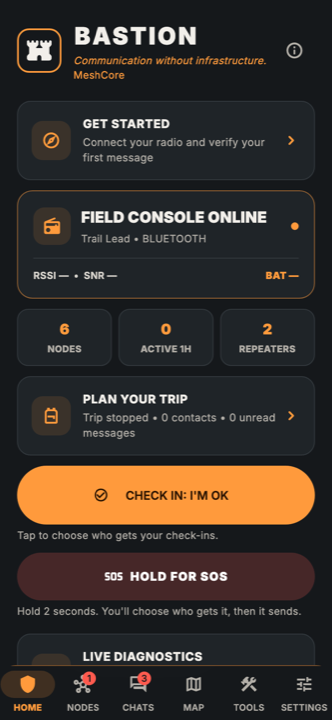
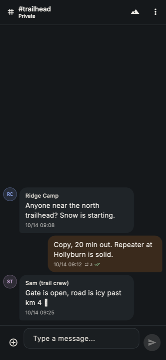
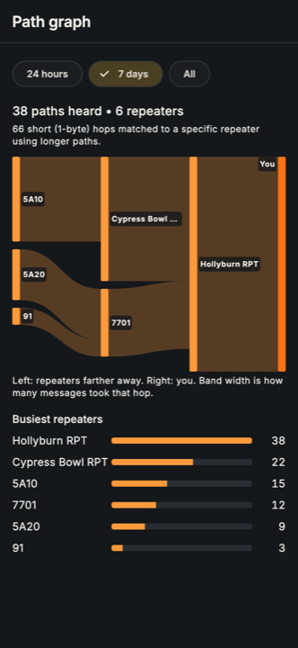
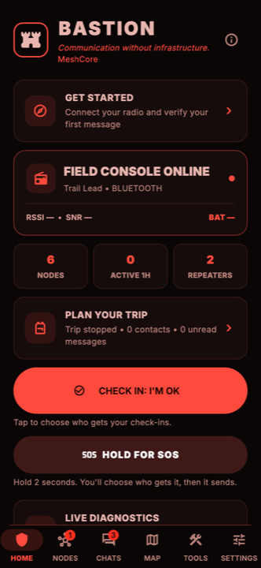
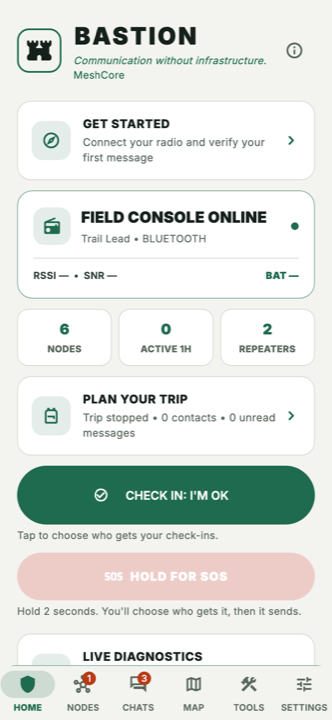
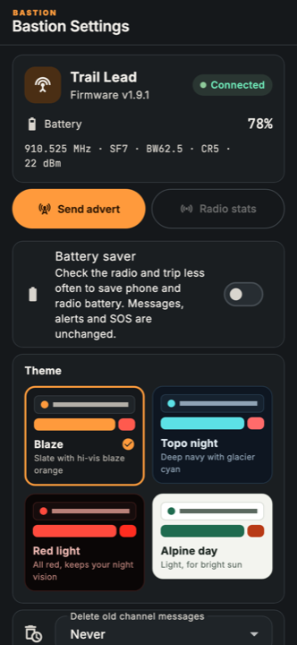

# Bastion

**Off-grid messaging, check-ins and SOS over your MeshCore LoRa radio.**

Bastion turns your phone or computer and a [MeshCore](https://meshcore.io/) radio into a field communicator that works without cell service, Wi-Fi or the internet. Messages hop from radio to radio across the mesh.

<p align="center">
  
  
  
</p>

> Bastion is a pre-release. It is tested in automated tests and a mesh simulator but not yet on a wide range of phones and radios. It is not a replacement for an emergency service or a satellite messenger. Please [report issues](../../issues).

## Download

Get the latest build from **[Releases](../../releases)**. Each release lists what changed.

| Platform | File | Notes |
|---|---|---|
| Android (ARM64 phones) | `Bastion-…-android-arm64.apk` | Signed with Bastion's release key |
| macOS (Intel and Apple silicon, macOS 14+) | `Bastion-…-macOS-universal.zip` | Not notarized by Apple (see below) |

iOS, Windows, Linux and web builds compile in CI but aren't released yet.

### Install on Android

1. On your phone, open the release and download the `.apk`.
2. Open the file. If Android asks, allow installs from your browser or file manager.
3. Open Bastion and allow **Bluetooth**, **location** and **notifications** when asked.

**Upgrading from a test build:** builds before 10.0.0-rc.10 were signed with a temporary test key, and Android won't install a release-signed build over them. First make an encrypted backup (**Tools → Encrypted backup**), then uninstall the old app, install the new one and restore. You only do this once. Later versions install as normal updates.

### Install on a Mac

1. Download the `.zip` from the release and double-click it to unzip.
2. Drag **Bastion** into your **Applications** folder.
3. Open it. The first time, macOS says it can't check the app for malicious software, because it isn't notarized by Apple.
   - Click **Done**, then open **System Settings → Privacy & Security**.
   - Scroll down and click **Open Anyway** next to "Bastion was blocked", then confirm.
   - You do this once for each new version.
4. Allow Bluetooth when asked.

Each release includes `SHA256SUMS` files if you want to check your download (`shasum -a 256 <file>`).

## Getting started

1. **Connect your radio.** On the home screen, tap **Get started**, or go to **Connect radio**. Bastion connects over Bluetooth, USB or TCP to a radio running MeshCore companion firmware.
2. **Say hello.** Open **Chats** and send a message on a channel, or open someone in **Nodes** to message them directly.
3. **Choose who gets your check-ins and SOS.** Tap **Check in: I'm OK** or hold **SOS**. The first time, Bastion asks who should get them. You can change this anytime in **Plan your trip**.
4. **Pick a look.** **Settings → Theme** offers Blaze (default), Topo night, Red light and Alpine day.

The **HOME** tab at the bottom always brings you back to the Field Console, where check-in and SOS live.

## Features

### Safety and trips
- **SOS:** hold for 2 seconds to send your radio's position to your trip contacts (and an optional channel). It repeats every 5 minutes until someone replies or you stop it, and **I'm safe** sends an all-clear.
- **Check-ins:** I'm OK, At camp, Delayed and Heading back. You see who each one reached, and can resend to anyone it missed.
- **Check-in reminders:** a phone notification when you're due to check in, even if Bastion is closed.
- **Overdue alerts:** a warning when a trip contact goes quiet for longer than you set.
- **Trip planning:** pick up to six contacts. Trip briefs, a Field Log of everything sent and received, and optional automations.

### Messaging
- Direct and channel messages with delivery status, reactions, GIFs and image messages.
- **Message search** across everything saved on the device.
- **Drafts** are kept per chat.
- **Share your position or a contact** from the message box. Received contacts can be added in one tap.
- **Read messages aloud** (optional), and on-device translation.
- **Area-limited channel messages** that stay within a radius of you. These need radios running flood-corridor firmware.
- Optional auto-delete of old channel messages.

### Maps, paths and coverage
- Live mesh map with offline map packs.
- **Path graph:** every path you've heard, drawn as flows from far repeaters to you, with the busiest repeaters ranked. Short (1-byte) hops are matched to a specific repeater using longer paths.
- **Antenna coverage:** see where an antenna at a chosen height could reach over the terrain.
- Line-of-sight checks, coverage capture sessions you can record and export, and route intelligence.

### Your radios
- Radio overview with battery, firmware and LoRa settings, plus live radio stats and a noise-floor chart.
- **Local mesh settings:** Bastion knows the settings that local meshes have agreed on (for example Philadelphia's 919.500 MHz preset). It tells you when your radio doesn't match, and switches it after you confirm. See [adding your area](#add-your-areas-mesh-settings).
- Repeater and room-server tools: login, status, neighbors, telemetry, command line and **access control**.
- **Live sensor updates:** sensors push readings when they change.
- Command line and Wi-Fi setup for your own radio. With permission, you can also use a trusted contact's command line.
- Bot Mode auto-replies, encrypted backup, battery saver and app-icon shortcuts.

### Look and feel
- Four themes: **Blaze**, **Topo night**, **Red light** (keeps your night vision) and **Alpine day** (for bright sun). All are checked for readable contrast.
- Available in 17 languages. Some of the newest screens are in English only for now.

<p align="center">
  
  
  
</p>

## Add your area's mesh settings

When a local mesh agrees on new radio settings, Bastion can offer them to everyone nearby. The list lives in [`assets/regional_presets.json`](assets/regional_presets.json). Bastion bundles a copy and checks GitHub for updates every 12 hours.

To add or update an area, open a pull request that edits that file. Each entry has:

```json
{
  "id": "us-philadelphia",
  "name": "Philadelphia",
  "center": [39.9526, -75.1652],
  "radiusKm": 100,
  "frequencyMHz": 919.5,
  "bandwidthKHz": 500,
  "spreadingFactor": 10,
  "codingRate": 5,
  "pathHashBytes": 2,
  "updated": "2026-10-17",
  "notes": "Where this comes from and anything people should know."
}
```

Please say in `notes` where the settings come from. Change `updated` whenever the settings change: that's what triggers the "settings changed" notification.

## Building from source

You'll need [Flutter](https://flutter.dev) 3.47 (stable).

```bash
flutter pub get
flutter run
```

Release builds:

```bash
flutter build apk --release --target-platform android-arm64
flutter build macos --release
```

The Android application ID is `com.bastionmesh.bastion`.

Before opening a pull request, run:

```bash
dart format lib test
flutter analyze
flutter test
```

### Project layout

- `lib/connector/`: MeshCore protocol and the Bluetooth, USB and TCP transports
- `lib/screens/`: app screens
- `lib/services/`: field ops, coverage, routing, notifications and other services
- `lib/models/`, `lib/storage/`: data and persistence
- `lib/theme/`: themes and colors
- `test/`: unit and widget tests; `test/preview/` renders screenshots (`PREVIEW_OUT=dir flutter test test/preview`)

## Contributing

Bug reports, feature requests and pull requests are welcome. Use the **[Issues](../../issues)** tab, and see [`CONTRIBUTING.md`](CONTRIBUTING.md) before opening a pull request.

## Independence and attribution

Bastion is an independent community app. It is not an official MeshCore app and doesn't imply endorsement by MeshCore. For MeshCore itself, see [meshcore.io](https://meshcore.io/).

Bastion builds on the open-source [MeshCore Open](https://github.com/zjs81/meshcore-open) project. License text and third-party notices are in [`LICENSE`](LICENSE), [`THIRD_PARTY_NOTICES.md`](THIRD_PARTY_NOTICES.md) and the app's Open source licenses screen.

## License

[MIT](LICENSE).
