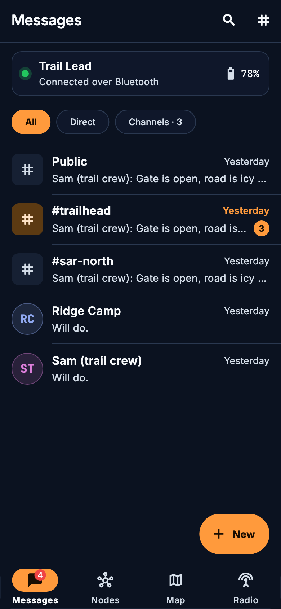
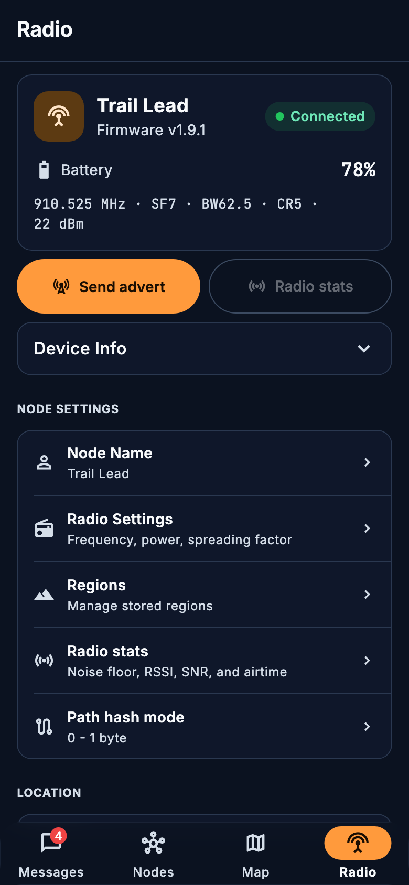

# Bastion

Open-source Flutter client for [MeshCore](https://github.com/meshcore-dev/MeshCore) LoRa mesh networking.

## Overview

**Bastion** is a cross-platform MeshCore client built for reliable off-grid communication. It connects to MeshCore companion radios over Bluetooth Low Energy (BLE), USB, or TCP and supports direct messages, channels, maps, node management, and repeater and room server administration.

**Repository:** [BastionMeshApp/Bastion-Meshcore-BCS](https://github.com/BastionMeshApp/Bastion-Meshcore-BCS)

### Project Direction

Bastion is being developed with an emphasis on:

- Reliable off-grid field operation
- Simple, low-distraction controls that work outdoors
- Offline-friendly tools and mapping
- Mesh diagnostics and network visibility
- Emergency and community communications
- Privacy and open-source development

> **Upstream credit:** Bastion is derived from the open-source [MeshCore Open](https://github.com/zjs81/meshcore-open) project. We appreciate the work of its developers and the broader MeshCore community. Bastion maintains its own branding, enhancements, and development direction while retaining applicable upstream licensing and attribution.

## Screenshots

<table>
  <tr>
    <td><br/><p align="center"><b>Messages</b></p></td>
    <td><br/><p align="center"><b>Nodes</b></p></td>
    <td><br/><p align="center"><b>Channel chat</b></p></td>
    <td><br/><p align="center"><b>Radio</b></p></td>
  </tr>
</table>

## Download

There is no store release yet. Every push to `dev` and every pull request builds an Android (ARM64) APK:

1. Open [Actions → Build Bastion APK](https://github.com/BastionMeshApp/Bastion-Meshcore-BCS/actions/workflows/build-apk.yml) and pick the latest successful run.
2. Download **Bastion-Android-ARM64** from the run's *Artifacts* section (requires a GitHub login; kept for 30 days).
3. Unzip it and install `Bastion-arm64-v8a.apk`, allowing installs from that source when Android asks.

## Features

### Messaging

- **Messages home**: Direct conversations and channels in one list, newest first, with filters, search, and unread counts
- **Direct Messaging**: Private encrypted conversations with individual contacts
- **Channels**: Public, hashtag, and private channels, including region-scoped channels
- **Area-limited channel messages** *(experimental)*: Keep a channel message within a radius of you, on radios running flood-corridor firmware
- **Reactions and Replies**: React with emoji and reply inline
- **Images over LoRa**: Send compressed images on channels (optional)
- **Translation**: Optional on-device message translation

### Nodes and Mesh Network

- **Nodes list**: People, repeaters, room servers, and sensors with hop count and last heard
- **Path Visualization**: View routing paths and signal quality for each contact
- **Route Management**: Manual path overriding and automatic route rotation
- **Node Discovery**: Automatic detection of nearby mesh nodes
- **Line of Sight**: Terrain profile between two points

### Map and Location

- **Live Map View**: Mesh nodes on an interactive map
- **Node Filtering**: Filter by node type and time range
- **Location Sharing**: Share GPS coordinates and custom markers with contacts
- **Offline Maps**: Download map tiles for offline use (with a [StadiaMaps](https://stadiamaps.com/pricing/) free API key)
- **MGRS Coordinates**: Military Grid Reference System coordinate format

### Radio

- **Radio tab**: Connected radio at a glance (battery, firmware, frequency and LoRa settings) with Send advert and Radio stats
- **BLE, USB, TCP Connection**: Connect to MeshCore companions over Bluetooth, USB, or TCP
- **Radio Settings**: Frequency, power, spreading factor, bandwidth, coding rate, and regions
- **Battery Monitoring**: Chemistry-specific voltage curves

### Repeater and Room Server Hub

- **CLI Access**: Full command-line interface to repeaters and room servers
- **Settings Management**: Configure repeater behavior, power limits, and network settings
- **Status and Neighbors**: Traffic, connected clients, neighbors, and system health
- **Remote Management**: Administer nodes from anywhere on the mesh

## Technical Details

### Architecture

- **Framework**: Flutter (current stable, 3.47+)
- **State Management**: Provider with ChangeNotifier
- **BLE Protocol**: Nordic UART Service (NUS) over Bluetooth Low Energy
- **Storage**: Local storage for messages, contacts, and settings
- **Encryption**: End-to-end encryption for private messages using the MeshCore protocol

### Platform Support

| Feature            | Android (API 21+) | iOS (12+) | Linux | Windows | macOS |                Web                |
|--------------------|:-----------------:|:---------:|:-----:|:-------:|:-----:|:---------------------------------:|
| BLE companion      | ✅                | ✅        | ✅   | ✅      | ✅    | ✅                                |
| USB companion      | ✅                | 🚧        | ✅   | ✅      | ✅    | ✅                                |
| TCP companion      | ✅                | 🚧        | ✅   | ✅      | ✅    | ❌<br>(requires websocket bridge) |
| Messaging          | ✅                | ✅        | ✅   | ✅      | ✅    | ✅                                |
| Nodes and Mesh     | ✅                | ✅        | ✅   | ✅      | ✅    | ✅                                |
| Map and Location   | ✅                | ✅        | ✅   | ✅      | ✅    | ✅                                |
| Radio              | ✅                | ✅        | ✅   | ✅      | ✅    | ✅                                |
| Repeater Hub       | ✅                | ✅        | ✅   | ✅      | ✅    | ✅                                |

### Dependencies

| Package | Purpose |
|---------|---------|
| flutter_blue_plus | Bluetooth Low Energy communication |
| provider | State management |
| shared_preferences | Local key-value storage (scoped per device) |
| flutter_map | Interactive map display |
| flutter_local_notifications | Background notification support |
| pointycastle | Cryptographic operations |
| llamadart | On-device LLM message translation |
| intl | Internationalization and date formatting |

## Getting Started

### Prerequisites

- Flutter SDK, current stable (3.47 or later)
- Android Studio / Xcode (for mobile development)
- A MeshCore-compatible LoRa device

### Installation

1. **Clone the repository**

   ```bash
   git clone https://github.com/BastionMeshApp/Bastion-Meshcore-BCS.git
   cd Bastion-Meshcore-BCS
   ```

2. **Install dependencies**

   ```bash
   flutter pub get
   ```

3. **Run the app**

   ```bash
   flutter run
   ```

### Building for Release

**Android APK:**

```bash
flutter build apk --release
```

**iOS:**

```bash
flutter build ios --release
```

## Project Structure

```
lib/
├── main.dart                     # App entry point
├── connector/
│   ├── meshcore_connector.dart   # Radio connection & state management
│   ├── meshcore_protocol.dart    # Protocol definitions & frame parsing
│   └── meshcore_uuids.dart       # Device names and IDs (add prefixes here!)
├── screens/
│   ├── scanner_screen.dart       # Device scanning (start screen)
│   ├── messages_screen.dart      # Messages home: chats and channels
│   ├── contacts_screen.dart      # Nodes list
│   ├── chat_screen.dart          # Direct messaging
│   ├── channel_chat_screen.dart  # Channel messaging
│   ├── map_screen.dart           # Network map
│   ├── settings_screen.dart      # Radio tab
│   └── repeater_hub_screen.dart  # Repeater / room server management
├── models/                       # Contacts, messages, channels, ...
├── services/                     # Notifications, retries, background, map cache, ...
├── theme/mesh_theme.dart         # Colors, type, and shared styles
└── storage/                      # Message, contact, and unread persistence
```

## BLE Protocol

### Nordic UART Service (NUS)

- **Service UUID**: `6e400001-b5a3-f393-e0a9-e50e24dcca9e`
- **RX Characteristic**: `6e400002-b5a3-f393-e0a9-e50e24dcca9e` (Write to device)
- **TX Characteristic**: `6e400003-b5a3-f393-e0a9-e50e24dcca9e` (Notify from device)

### Device Discovery

Devices are discovered by scanning for BLE advertisements with known MeshCore device name prefixes. These are currently:
    - `MeshCore-`
    - `Whisper-`
    - `WisCore-`
    - `HT-`
    - `LowMesh_MC_`
    - `NRF52`

New device prefixes can be added in `lib/connector/meshcore_uuids.dart`.

### Message Format

Messages are transmitted as binary frames using a custom protocol optimized for LoRa transmission. See `meshcore_protocol.dart` for frame structure definitions.

## Configuration

### App Settings

- **Theme**: System default, light, or dark mode
- **Language**: 18 languages (English, Bulgarian, Chinese, Dutch, French, German, Hungarian, Italian, Japanese, Korean, Polish, Portuguese, Russian, Slovak, Slovene, Spanish, Swedish, Ukrainian)
- **Notifications**: Configurable for messages, channels, and node advertisements
- **Battery Chemistry**: Support for NMC, LiFePO4, and LiPo battery types
- **Message Retry**: Automatic retry with configurable path clearing

### Device Settings

- **Radio Power**: Transmit power adjustment
- **Frequency**: LoRa frequency configuration
- **Bandwidth**: Channel bandwidth selection
- **Spreading Factor**: Range vs. speed trade-off
- **Regions**: Region scopes for flood traffic

## Contributing

This is an open-source project. Contributions are welcome!

### Development Guidelines

- Follow the Flutter style guide
- Use Material 3 design components and the shared theme in `lib/theme/mesh_theme.dart`
- Write clear commit messages
- Test on both Android and iOS before submitting PRs

### Code Style

- Prefer `StatelessWidget` with `Consumer` for reactive UI
- Use `const` constructors where possible
- Keep functions small and focused
- Avoid premature abstractions
- Run `dart format` on all changes before submitting

## Support

For issues, questions, compatibility reports, or feature requests, please use the [Bastion GitHub Issues](https://github.com/BastionMeshApp/Bastion-Meshcore-BCS/issues) page.

## License and Upstream Attribution

Bastion is based on open-source upstream software. This project is intended to retain and comply with all applicable upstream license, copyright, and attribution requirements.

See the repository's license and source files for complete licensing information. The upstream MeshCore Open project is available at [zjs81/meshcore-open](https://github.com/zjs81/meshcore-open).

## Acknowledgments

- Built with [Flutter](https://flutter.dev/)
- Map tiles from [OpenStreetMap](https://www.openstreetmap.org/)
