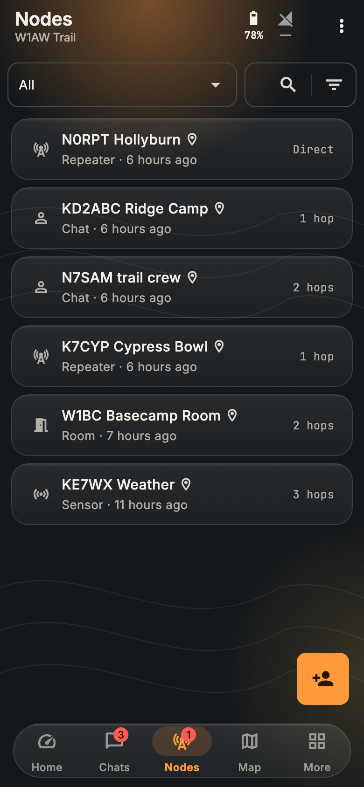
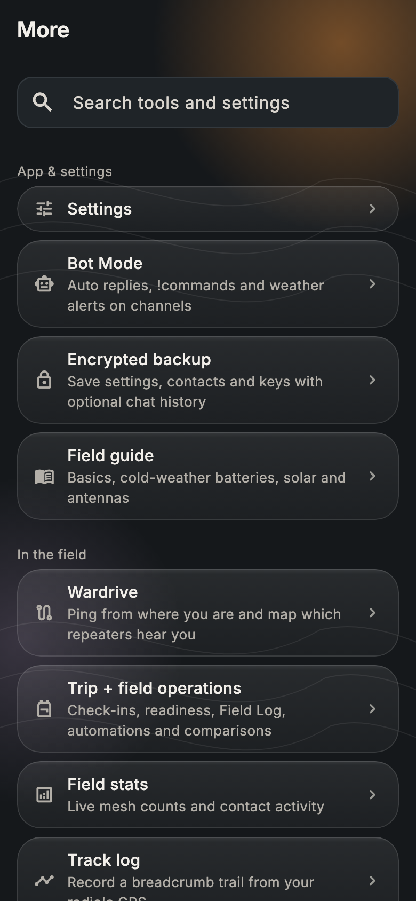
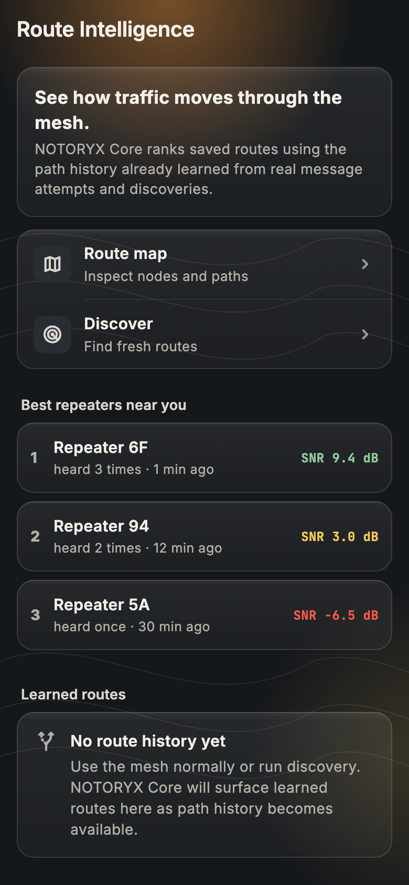

<p align="center">
  
</p>

# NOTORYX Core Ham

Part of the **NOTORYX** off-grid communications family. **No Towers. No Limits.**

> NOTORYX Core Ham is the amateur radio edition of NOTORYX Core, for licensed operators. It installs as a separate app (`com.bastionmesh.ham`) next to NOTORYX Core. Licensed Operator Mode (call-sign ID, no encryption, Part 97 power settings) is in development and needs the NOTORYX Core Ham firmware; until then the app behaves like NOTORYX Core. See [docs/licensed-operator](docs/licensed-operator).

**Off-grid messaging, check-ins and SOS over your MeshCore LoRa radio.**

NOTORYX Core Ham turns your phone or computer and a [MeshCore](https://meshcore.io/) radio into a field communicator that works without cell service, Wi-Fi or the internet. Messages hop from radio to radio across the mesh.

<p align="center">
  
  
  
</p>

> NOTORYX Core Ham is a pre-release. It is tested in automated tests and a mesh simulator but not yet on a wide range of phones and radios. MQTT bridging and LetsMesh sign-in are new and still need wider real-world testing. It is not a replacement for an emergency service or a satellite messenger. Please [report issues](../../issues).

## Download

Get the latest build from **[NOTORYX Core Ham releases](https://github.com/TheLogsAreScreaming/NOTORYX-Core-Ham-Releases/releases)**. Each release lists what changed.

| Platform | File | Notes |
|---|---|---|
| Android (ARM64 phones) | `NOTORYX-Core-Ham-…-arm64-v8a.apk` | Signed with the existing release key |
| macOS (Intel and Apple silicon, macOS 14+) | `NOTORYX-Core-Ham-…-macOS-universal.zip` | Not notarized by Apple (see below) |

iOS, Windows, Linux and web builds compile in CI but aren't released yet.

### Install on Android

**Easiest: get updates automatically with [Obtainium](https://obtainium.imranr.dev/).** On your phone, install Obtainium, then tap the badge below. It adds NOTORYX Core Ham with pre-releases included and the Android APK picked out, and tells you when a new build is out.

<p><a href="https://apps.obtainium.imranr.dev/redirect?r=obtainium://app/%7B%22id%22%3A%22com.bastionmesh.ham%22%2C%22url%22%3A%22https%3A%2F%2Fgithub.com%2FTheLogsAreScreaming%2FNOTORYX-Core-Ham-Releases%22%2C%22author%22%3A%22TheLogsAreScreaming%22%2C%22name%22%3A%22NOTORYX%20Core%20Ham%22%2C%22additionalSettings%22%3A%22%7B%5C%22includePrereleases%5C%22%3Atrue%2C%5C%22apkFilterRegEx%5C%22%3A%5C%22arm64-v8a%5C%5C%5C%5C.apk%24%5C%22%2C%5C%22autoApkFilterByArch%5C%22%3Atrue%2C%5C%22versionDetection%5C%22%3Atrue%7D%22%7D"></a></p>

Or install the APK yourself:

1. On your phone, open the release and download the `.apk`.
2. Open the file. If Android asks, allow installs from your browser or file manager.
3. Open NOTORYX Core Ham and allow **Bluetooth**, **location** and **notifications** when asked.

**Upgrading from a test build:** builds before 10.0.0-rc.10 were signed with a temporary test key, and Android won't install a release-signed build over them. First make an encrypted backup (**More → Encrypted backup**), then uninstall the old app, install the new one and restore. You only do this once. Later versions install as normal updates.

### Install on a Mac

1. Download the `.zip` from the release and double-click it to unzip.
2. Drag **NOTORYX Core Ham** into your **Applications** folder.
3. Open it. The first time, macOS says it can't check the app for malicious software, because it isn't notarized by Apple.
   - Click **Done**, then open **System Settings → Privacy & Security**.
   - Scroll down and click **Open Anyway** next to "NOTORYX Core Ham was blocked", then confirm.
   - You do this once for each new version.
4. Allow Bluetooth when asked.

Each release includes `SHA256SUMS-Android.txt` and `SHA256SUMS-macOS.txt` if you want to check your download (`shasum -a 256 <file>`).

## Getting started

1. **Connect your radio.** On the home screen, tap **Get started**, or go to **Connect radio**. NOTORYX Core Ham connects over Bluetooth, USB or TCP to a radio running MeshCore companion firmware, and reconnects to your last radio on its own.
2. **Say hello.** Open **Chats** and send a message on a channel, or open someone in **Nodes** to message them directly.
3. **Choose who gets your check-ins and SOS.** Tap **Check in: I'm OK** or hold **SOS**. The first time, NOTORYX Core Ham asks who should get them. You can change this anytime in **Plan your trip**.
4. **Set your radio for your area.** **Settings → Radio settings → Presets** lists MeshCore's community presets (USA, Canada, EU/UK, Australia and more) with the one for your country suggested first.
5. **Pick a look.** **Settings → Theme** offers Blaze (default), Topo night, Red light and Alpine day.

The tabs at the bottom are **Home**, **Chats**, **Nodes**, **Map** and **More**. Home is where check-in, SOS and your radio's readings live; **More** holds every tool and setting, with a search box.

## Features

### Safety and trips
- **SOS:** hold for 2 seconds to send your radio's position to your trip contacts (and an optional channel). It repeats every 5 minutes until someone replies or you stop it, and **I'm safe** sends an all-clear.
- **Signed SOS:** an SOS on a channel carries a signature from your radio's own key, so other NOTORYX users can see it really came from you. You can sign every channel post too. A post whose signature doesn't check out is shown as unverified, and other apps just see the normal message.
- **Check-ins:** I'm OK, At camp, Delayed and Heading back. You see who each one reached, and can resend to anyone it missed.
- **Check-in reminders and overdue alerts:** a notification when you're due to check in, and a warning when a trip contact goes quiet for longer than you set.
- **Trip planning:** pick up to six contacts. Trip briefs, a Field Log of everything sent and received, and optional automations.
- **Android home-screen widget:** radio status, battery and unread count, with one-tap Check in and SOS.

### Messaging
- Direct and channel messages with delivery status, reactions, GIFs and image messages. Tapping a notification opens that chat.
- **Find channels:** a directory of public hashtag channels (local ones first), channels heard on air that you haven't joined, and **Active online**: the #channels an online analyzer has seen in use, with one-tap Join.
- **Message search**, per-chat **drafts**, **read aloud** and on-device translation.
- **Share your position or a contact** from the message box. Received contacts can be added in one tap.
- **Link previews** (off by default, since fetching one tells the site your IP address).
- **Area-limited channel messages** that stay within a radius of you. These need radios running flood-corridor firmware.
- Optional auto-delete of old channel messages.

### Maps, paths and coverage
- Live mesh map with offline map packs, and a **track log** that records your trail and exports GPX.
- **Path graph:** every path you've heard, drawn as flows from far repeaters to you. Short (1-byte) hops are matched to a specific repeater using longer paths.
- **Route Intelligence:** learned routes and the best repeaters your radio hears directly.
- **Observer reach:** check which online observers heard a message you sent, how many hops it took and the best signal. Repeaters you don't have as contacts can be named online. Both use a CoreScope analyzer you choose in Settings.
- **Coverage hexagons:** record where your radio got through and upload to your own HTTPS endpoints, with a privacy delay.
- **Antenna coverage** over the terrain, line-of-sight checks and coverage capture sessions.

### Your radio
- **Sensors on Home:** your radio's own readings (battery voltage, temperatures, GPS, light and whatever else it reports).
- **Radio presets:** MeshCore's community catalogue with search and a suggestion for your country. Choosing one keeps your transmit power. Local mesh settings (for example Philadelphia's) are offered when your radio is in that area; see [adding your area](#add-your-areas-mesh-settings).
- **Send your advert** zero-hop (only radios that hear you directly) or flooded across the mesh.
- Connections dashboard, live radio stats and a noise-floor chart, adjustable refresh rate and battery saver.
- Command line and Wi-Fi setup for your own radio. With permission, you can also use a trusted contact's command line.

### Field tools
- **Repeater ping:** a one-hop trace showing the signal both ways. **Antenna hunt:** clicks faster as a chosen repeater gets louder.
- Repeater and room-server tools: login, status, neighbors, telemetry, command line and **access control**.
- **Repeater IDs** (who uses an ID, which are free) and **Region setup** (US and Canada region trees, or your own) for repeater owners.
- **Bot Mode:** local auto-replies, keyword rules and commands like `!ping`, `!sun`, `!moon`, `!weather`, `!dice` and `!trace`, in direct messages and in the channels you choose. It can also post weather alerts to a channel.
- **Field guide**, encrypted backup and app-icon shortcuts.

### MQTT bridge (optional)
- **Several brokers at once** over TLS or secure WebSocket, with a Wi-Fi-only option and an offline queue that sends when you're back online. Broker passwords are kept in the system keychain.
- **Live packet feed.** Channel messages that reached you only over the internet are marked **via MQTT**, and never count as radio repeats.
- **Observer sharing** in the community `meshcoretomqtt` format. It's off until you turn it on, and direct messages and your own traffic each need a separate opt-in.
- **LetsMesh-style sign-in** with a token signed by your radio, so its private key never leaves it. LetsMesh (US and EU) and MeshRank presets are included; they're community services, not part of NOTORYX.

### Look and feel
- **Frosted ember:** the main screens sit on a warm glow, with see-through glass panels and a floating tab bar. With reduce motion turned on, the blur is off.
- Four themes: **Blaze**, **Topo night**, **Red light** (keeps your night vision) and **Alpine day** (for bright sun).
- Available in 18 languages.

<p align="center">
  
  
  
</p>

<p align="center">
  
  
  
</p>

## Add your area's mesh settings

When a local mesh agrees on new radio settings, NOTORYX Core Ham can offer them to everyone nearby. The live list is [`regional_presets.json` in NOTORYX-Core-Ham-Releases](https://github.com/TheLogsAreScreaming/NOTORYX-Core-Ham-Releases/blob/main/regional_presets.json), which NOTORYX Core Ham checks every 12 hours. The app also bundles a copy, [`assets/regional_presets.json`](assets/regional_presets.json), for first launch and offline use; update it to match the live list before each release.

To add or update an area, [open an issue in NOTORYX-Core-Ham-Releases](https://github.com/TheLogsAreScreaming/NOTORYX-Core-Ham-Releases/issues/new). Each entry has:

```json
{
  "id": "us-philadelphia",
  "name": "Philadelphia",
  "center": [39.9526, -75.1652],
  "radiusKm": 100,
  "frequencyMHz": 919.5,
  "bandwidthKHz": 500,
  "spreadingFactor": 10,
  "codingRate": 5,
  "pathHashBytes": 2,
  "updated": "2026-10-17",
  "notes": "Where this comes from and anything people should know."
}
```

Please say in `notes` where the settings come from. Change `updated` whenever the settings change: that's what triggers the "settings changed" notification.

## Building from source

You'll need [Flutter](https://flutter.dev) 3.47 (stable).

```bash
flutter pub get
flutter run
```

Release builds:

```bash
flutter build apk --release --target-platform android-arm64
flutter build appbundle --release   # Google Play
flutter build macos --release
```

The Android application ID is `com.bastionmesh.ham`, so it installs next to NOTORYX Core (`com.bastionmesh.bastion`).

Before opening a pull request, run:

```bash
dart format lib test
flutter analyze --fatal-infos
flutter test
```

### Project layout

- `lib/connector/`: MeshCore protocol and the Bluetooth, USB and TCP transports
- `lib/screens/`: app screens
- `lib/services/`: field ops, coverage, routing, MQTT, notifications and other services
- `lib/models/`, `lib/storage/`: data and persistence
- `lib/theme/`: themes and colors
- `test/`: unit and widget tests; `test/preview/` renders screenshots (`PREVIEW_OUT=dir flutter test test/preview`, with `PREVIEW_THEME=alpine_day` or `red_light` for other themes)

## Contributing

Bug reports, feature requests and pull requests are welcome. Use the **[Issues](../../issues)** tab, and see [`CONTRIBUTING.md`](CONTRIBUTING.md) before opening a pull request.

## Independence and attribution

NOTORYX Core Ham is an independent community app. It is not an official MeshCore app and doesn't imply endorsement by MeshCore. For MeshCore itself, see [meshcore.io](https://meshcore.io/).

NOTORYX Core Ham builds on the open-source [MeshCore Open](https://github.com/zjs81/meshcore-open) project. License text and third-party notices are in [`LICENSE`](LICENSE), [`THIRD_PARTY_NOTICES.md`](THIRD_PARTY_NOTICES.md) and the app's Open source licenses screen.

## License

[MIT](LICENSE).
